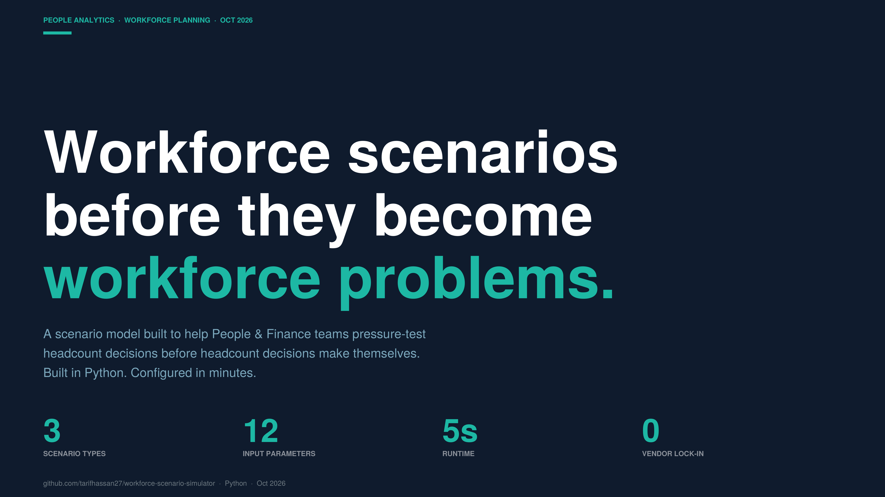
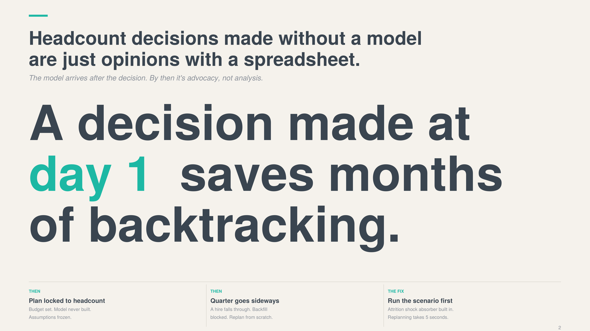
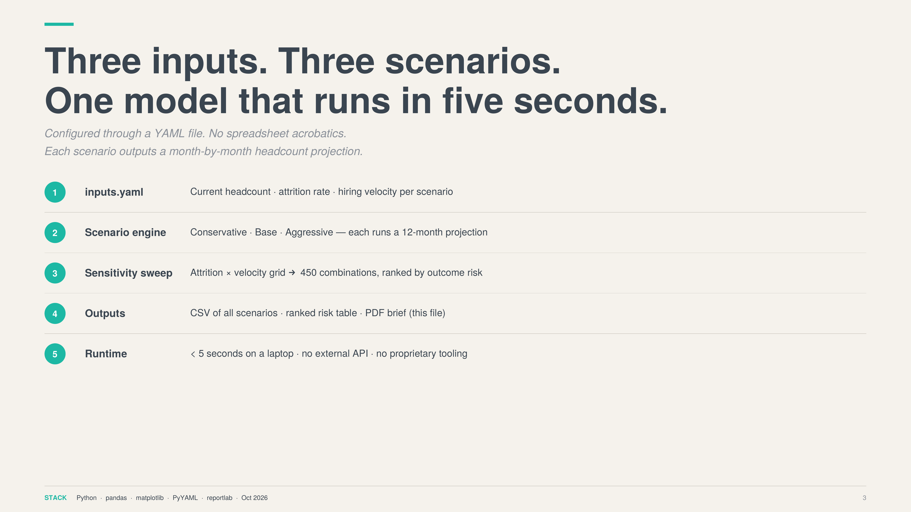
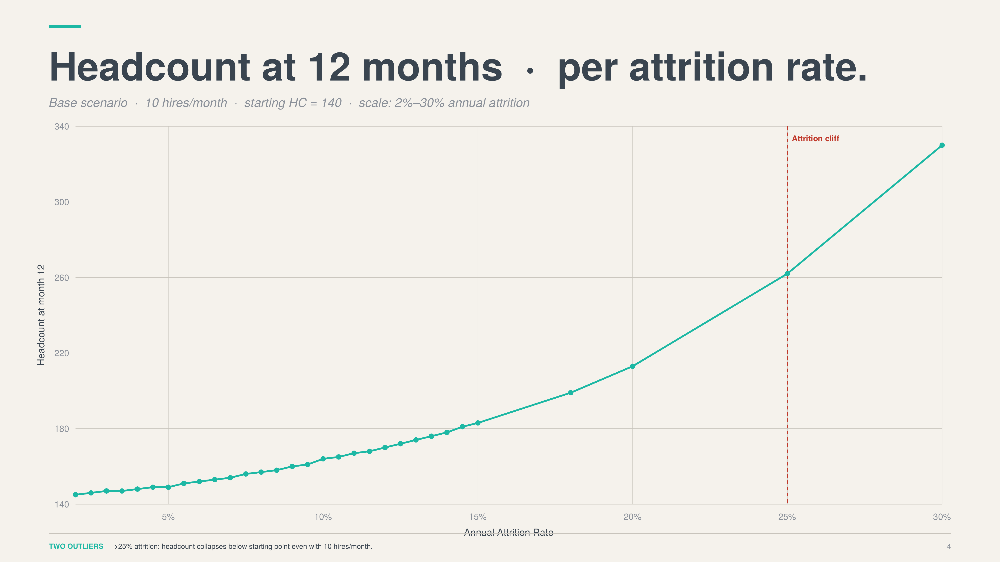
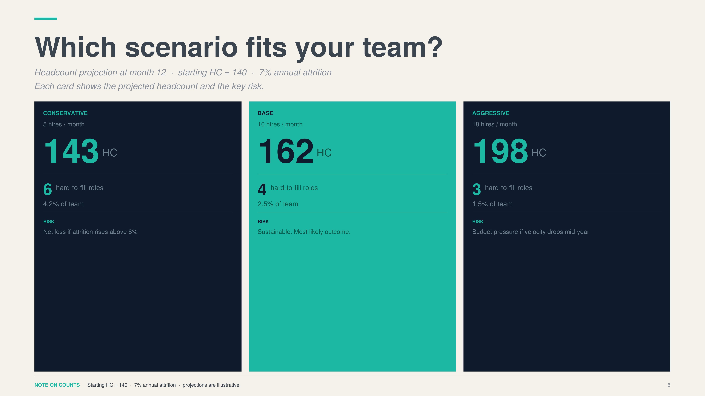
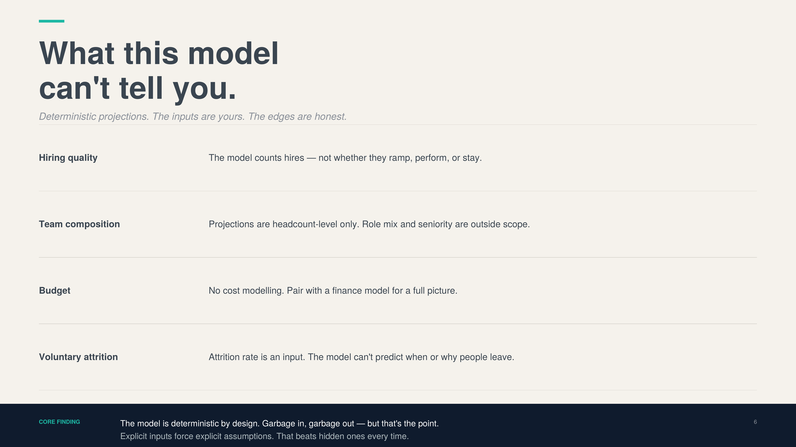

# Workforce Scenario Simulator

A decision-support model for a hypothetical CHRO question: **can you cut 5% of workforce
cost without losing your critical talent?** Built end to end — synthetic HRIS data, SQL
role-criticality logic, a Python scenario model, a sensitivity analysis, and an interactive
slider-driven Power BI dashboard — for a fictional ~2,000-employee company, Meridian Cloud.



## Business Problem

Meridian Cloud's CHRO has been asked to cut workforce cost by 5% — about **$14.6M** off a
**$292.3M** fully-loaded annual cost base — without quietly gutting the roles the business
actually depends on. The brief tests three commonly reached-for levers against that single
pass/fail bar: a **hiring freeze**, **delayering** (removing a layer of management), and
**targeted layoffs**. A lever only "works" if it clears the savings target *and* loses zero
critical positions.



## Method

Before any lever touches the workforce, every one of the 2,004 employees across 47 roles is
scored against a modified Huselid/Beatty/Becker workforce-differentiation framework:

- **A** — strategic impact *and* performance variance clears a threshold
- **B-HR** — not strategic, but few qualified backups *and* a long time-to-hire (hard to replace)
- **B** — supports an A-role, or is strategic without clearing the variance bar
- **C** — everything else; the only pool any lever is allowed to touch

This split (**384 A / 836 B / 319 B-HR / 465 C**) is derived in SQL from raw HRIS fields —
rating variance, replaceability thresholds, and a seeded business-judgment flag — not assumed.



## Finding 1 — Hiring Freeze

A blanket hiring freeze (no exemptions) clears the cost line: attrition alone delivers
**~5.6%** in savings. But because it can't distinguish a departing critical employee from
anyone else, it costs **77–90 protected (A / B-HR) positions** across the seeds tested, with
zero control over who. **Verdict: FAIL** — it fails the protection criterion, not the cost one.



## Finding 2 — Targeted Layoffs

Ranking the eligible C-role pool by lowest performance rating first and laying off from the
bottom clears the target at **5.02%** savings with zero protected-role losses. **Verdict: PASS.**
A full sensitivity sweep (2–30 weeks/year of tenure, in 0.5-week steps) shows the lever
passes at **every tested severance level** — the algorithm simply lays off more C-role employees
to keep clearing 5%, with 145 laid off at the current assumption rising to 330 at 15×.
The finding is robust, not fragile.

**Structural limitations to state plainly:** the C pool is pre-defined by the same model
that runs the layoffs, so the result is partly circular — employees tagged C are precisely
those the lever is designed to reach. This is a valid analytical choice (the framework
intentionally restricts cuts to the non-critical pool), but it should be read as
*"this is achievable without losing critical talent"*, not as an independent validation
that the target pool is the right one.

*(Delayering was also tested: it protects everyone but only saves 0.61% of baseline — FAIL
on the cost criterion. Not slider-driven in the dashboard since its parameters weren't in
scope for v1; see `04_scenario_model/`.)*



## Interactive Dashboard (.pbix)

Five What-If Parameter sliders (severance weeks, attrition rate, and the three criticality
thresholds) drive DAX measures that reproduce the SQL and Python results, so a reviewer can
stress-test the assumptions without re-running anything. The Targeted Layoffs lever uses a
precomputed lookup table (27 severance values) loaded via LOOKUPVALUE() — full rationale
in the DAX spec.

**To open:** download `05_powerbi/workforce_scenario_simulator.pbix` and open in
[Power BI Desktop](https://powerbi.microsoft.com/desktop/) (free, Windows only).

Build notes (including three real DAX bugs hit and fixed) and the DAX measure spec are in
[`05_powerbi/phase6_notes.md`](05_powerbi/phase6_notes.md) and
[`05_powerbi/phase6_dax_spec.md`](05_powerbi/phase6_dax_spec.md).



## Repo structure

```
01_business_problem/   problem statement, scope, and lever definitions
02_data/               synthetic data generator + tagging pipeline
03_sql/                role-criticality logic (A/B/B-HR/C)
04_scenario_model/     Python lever simulations + sensitivity analysis
05_powerbi/            interactive dashboard (.pbix), DAX spec, build notes
06_executive_brief/    LinkedIn carousel deck (PDF + PNGs)
```

Built by Tarif Hassan.
